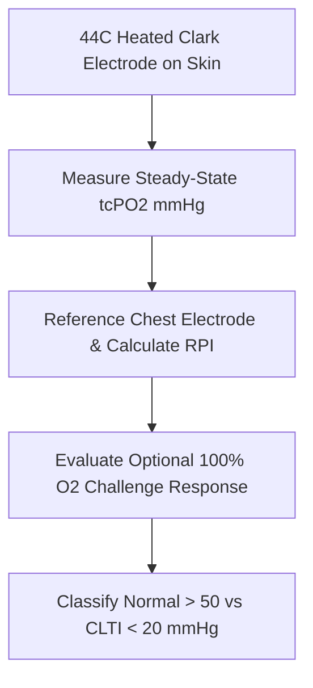

# Cutaneous Transcutaneous Oxygen (tcPO2) Personal Agent Skill

[](LICENSE)
[](https://www.python.org/)
[]()
[]()
[]()

Deterministic, zero-mock personal agent micro-skill for calculating Transcutaneous Oxygen Pressure ($tcPO_2$ in mmHg) and Regional Perfusion Index (RPI) using heated Clark polarographic sensor physics to evaluate ischemic wound healing potential.

## Architecture



## Quickstart

```python
from client import TranscutaneousOxygenClient

client = TranscutaneousOxygenClient()
result = client.evaluate_tcpo2(
    limb_tcpo2_mmhg=62.0,
    chest_reference_tcpo2_mmhg=66.0
)
print(result)
```

## License

Apache-2.0
